# Assignment 3: Training Agents with Reinforcement Learning

**Hanmo Zhang**

**AndrewID: hanmozha**

Each section ends with the full standard diagnostic plots for its runs. Dashed lines are evaluations; gaps in a line mark steps where every group was degenerate, so no update ran.

## Part 2: Synchronous REINFORCE and GRPO

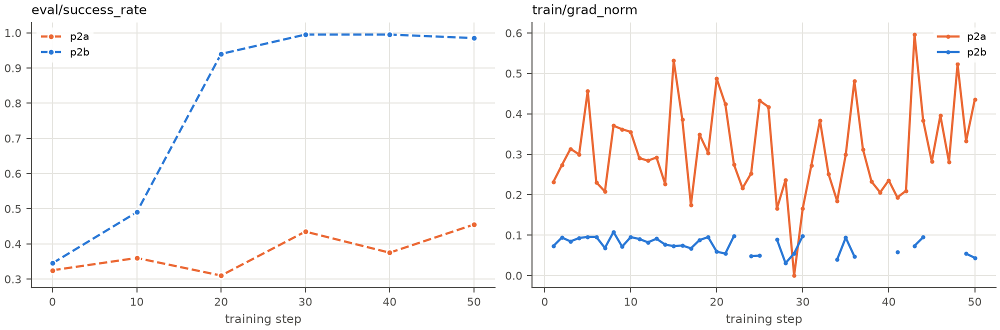

*Figure 1: p2a vs. p2b, `eval/success_rate` (left) and `train/grad_norm` (right).*

GRPO (p2b) learns much faster than REINFORCE (p2a): eval success rose from 0.345 to 0.94 by step 20 and ended at 0.985. REINFORCE only crept from 0.325 to 0.455. This makes sense -- REINFORCE uses the raw reward as its advantage with no baseline, so failed episodes contribute no gradient and the update is high-variance; its larger mean `grad_norm` (0.31 vs. 0.075 for GRPO) is consistent with this, though it also averages over far fewer sequences per update. It also sees 8× fewer episodes per step. GRPO's group-mean baseline compares several attempts at the same task, so failures are actively pushed down, giving a lower-variance signal with more useful sequences per step.

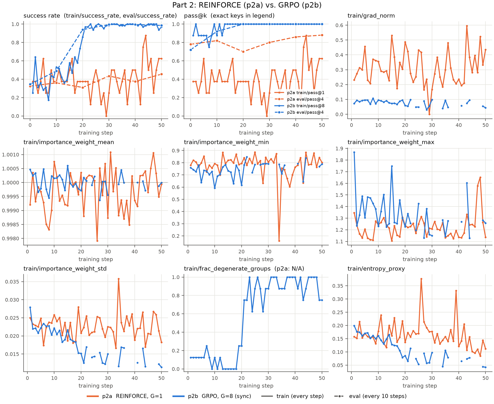

*Figure 2: Standard diagnostics, p2a vs. p2b. p2a's training success and `train/pass@1` stay noisy and average 0.4–0.5, and its `eval/pass@4` only edges up from 0.78 to 0.88. p2b's `train/pass@8` is 1.0 from step 13 and its `eval/pass@4` reaches 1.0 by step 20. Importance weights stay near 1 for both runs (std ≈ 0.02), as expected for on-policy training. The one exception is a single dip in p2a's minimum to 0.16 at step 34; that step's mean (≈ 1.000) and std (0.036) barely move, so it is one outlier token from sampler/trainer mismatch rather than policy drift. p2b's degenerate fraction jumps to 0.6–1.0 after step 20 as it solves the tasks (N/A for p2a), and its entropy falls from 0.18 to 0.04, against 0.17 to 0.11 for p2a.*

## Part 3: Asynchronous GRPO

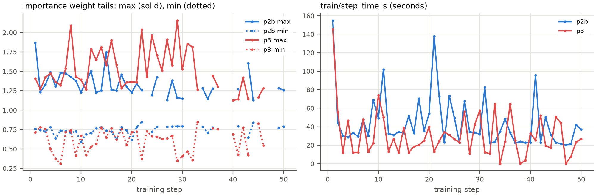

*Figure 3: Importance-weight max (solid) and min (dotted) for p3 vs. the on-policy p2b (left); `train/step_time_s` for both runs (right).*

p3 reached 0.995 eval success. Its mean importance weight stayed at 1.000, but the tails were wider than the synchronous run's:

| | min IW | max IW | mean IW std |
|---|---|---|---|
| p2b (on-policy) | 0.59 | 1.87 | 0.018 |
| p3 (async) | 0.31 | 2.15 | 0.024 |

p2b is on-policy, so its spread is only sampler/trainer numerical mismatch; p3's extra spread is the off-policy drift from training on groups up to two versions old. The gap also holds over the matched steps 1–20, before either run converged and with about 58 sequences per update in both (std 0.021 vs. 0.025), so it isn't an artifact of p2b converging earlier. Per step, p3 was 1.48× faster than p2b (mean `step_time_s` 30.4 s vs. 44.9 s; 25.3 vs. 37.4 min total).

The transcripts show the agent learning to use the feedback and to bisect:
- **Early (step 5, `number_search.train.57`, `policy_version` 3):** told 979 was too high and 969 too low, it guessed 979, 989 and 999 anyway, and ran out of steps.
- **Middle (step 25, `number_search.train.223`, `policy_version` 23):** one rollout bisected cleanly to the target, while another drifted into a linear +4 scan in the wrong direction.
- **Late (step 45, `number_search.train.392`, `policy_version` 39):** every guess was the midpoint of the remaining interval, and all 8 rollouts produced the same sequence.

Across all transcripts, guesses that the feedback had already ruled out fell from 11–17% (steps 5–15) to under 0.5% (step 30 onward). The policy also became deterministic.

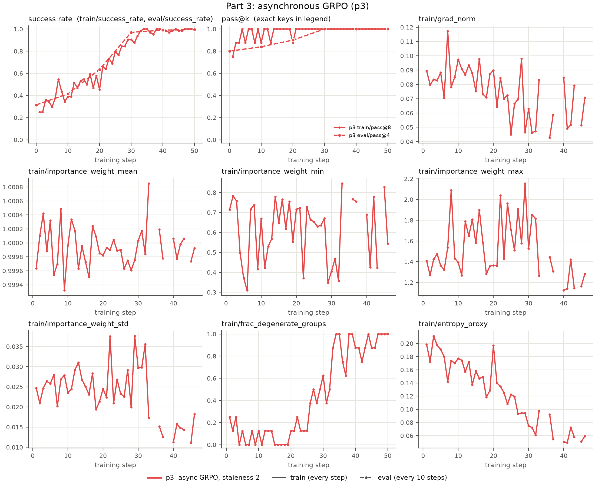

*Figure 4: Standard diagnostics, p3. Training success climbs from 0.30 to about 1.0; `train/pass@8` stays at 1.0 from step 21 and `eval/pass@4` reaches 1.0 by step 30. `grad_norm` drifts down from about 0.09 to 0.06 as more groups become degenerate (0.10 in steps 1–10, 0.93 in steps 41–50), and entropy falls from 0.19 to 0.06 as the policy becomes deterministic. The importance-weight std shrinks from 0.025 to 0.015 once the policy stops changing quickly.*

## Part 4.1: Group size

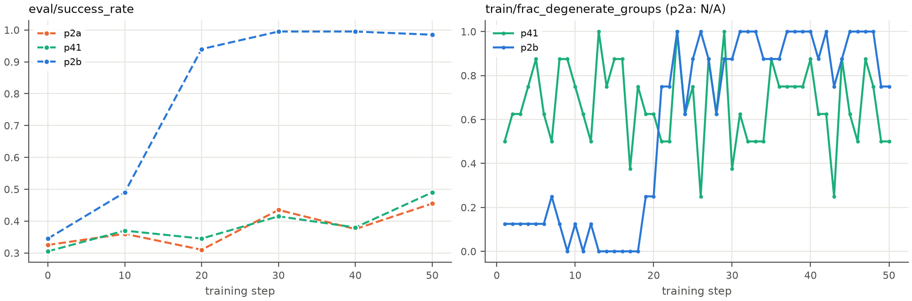

*Figure 5: `eval/success_rate` for G = 1, 2 and 8 (left); `train/frac_degenerate_groups` for p41 and p2b (right; N/A for p2a).*

Shrinking the group from 8 to 2 nearly erased GRPO's advantage. p41 (G=2) finished at 0.49 eval success, about the same as REINFORCE (0.455), while p2b (G=8) reached 0.985. With G=2 the baseline is a single other sample, so every advantage is 0 or ±0.5. Those advantages are large and noisy; the gradient norm is about 4× p2b's, consistent with this, though p41 also averages over far fewer sequences per update. Worse, the two rollouts agree in 67% of groups, which contributes no gradient (the degenerate fraction is N/A for REINFORCE). Only about 5 of 16 episodes per step were useful, vs. about 27 of 64 for p2b; p2b's high fraction comes only after step 20, once it had solved the tasks. This isn't a pure group-size ablation, since p2a also differs in its advantage rule and loss.

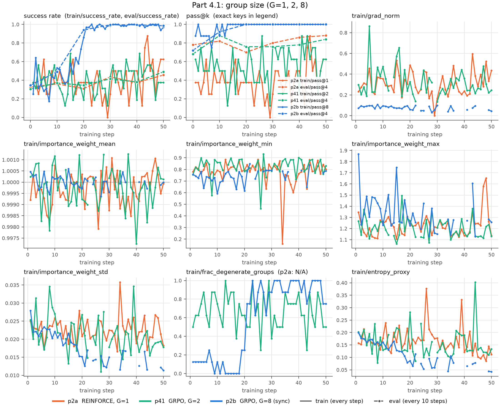

*Figure 6: Standard diagnostics, G = 1, 2 and 8. Training success and `train/pass@k` never trend clearly upward for p2a (`train/pass@1`) or p41 (`train/pass@2`), and their `eval/pass@4` moves only from 0.78 to 0.88 (p2a) and 0.68 to 0.84 (p41). Both small-group runs have a `grad_norm` around 0.3 (max 0.86 for p41) vs. about 0.08 for p2b, and end with much higher entropy (0.11 and 0.13 vs. 0.04). Importance weights stay near 1 for all three runs, as expected for synchronous training; the minima mostly sit between 0.6 and 0.9, apart from isolated single-token dips (p2a to 0.16 at step 34, p41 to 0.46 at step 26) that leave the mean and std unchanged.*

## Part 4.2: Synchronous vs. asynchronous training

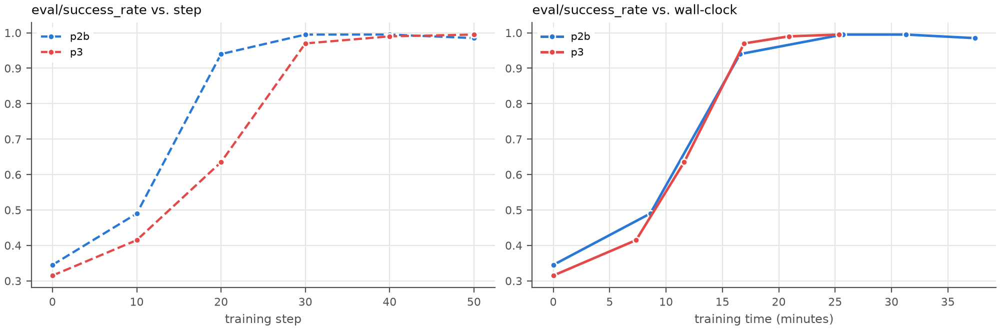

*Figure 7: `eval/success_rate` for p2b and p3 against training step (left) and against cumulative training time (right).*

Async p3 is 1.48× faster per step (30.4 s vs. 44.9 s) and finished at the same quality: 0.995 vs. 0.985 final eval success. The speedup comes from overlapping sampling with training. Sync p2b samples a full batch, waits for its slowest episode, then updates, and its learner idles for 67% of each step. In p3, eight workers keep generating while the learner updates, cutting the idle share to 41%. p3 did learn more slowly per step (0.635 eval success at step 20 vs. 0.94 for p2b), likely due to stale data, though asynchronous batching also changes which groups enter a batch. Measured against wall-clock time (right panel), though, the two curves essentially coincide. The cost likely stayed small because the staleness filter dropped 38 overly stale groups (about 9%) and the PPO loss clipped the importance ratio on the rest. The mean importance weight stayed at 1.000, with a maximum of 2.15.

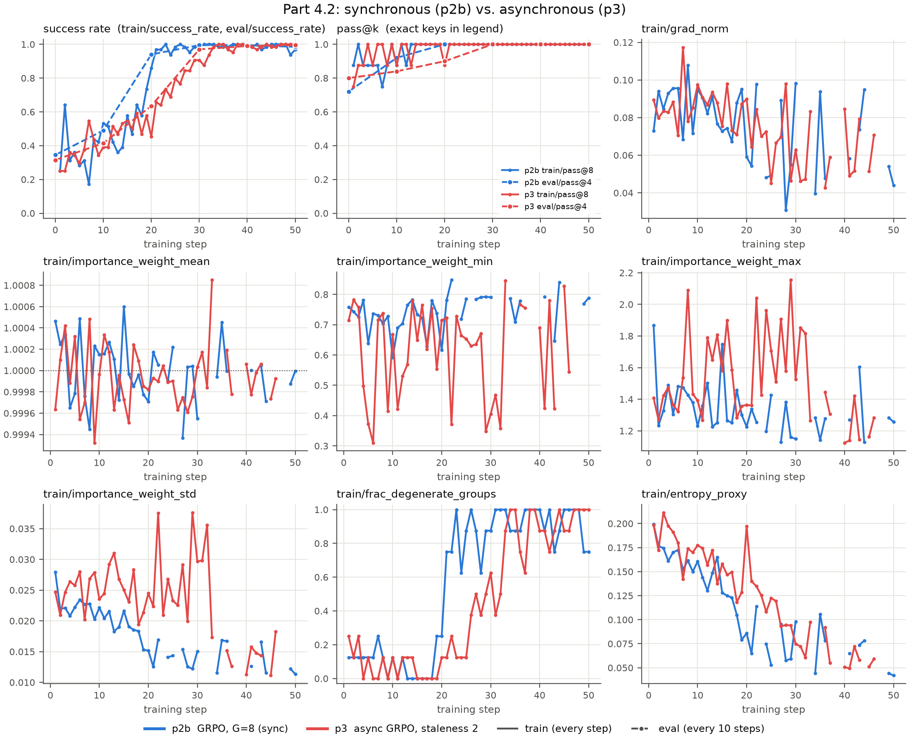

*Figure 8: Standard diagnostics, p2b vs. p3. p3's `train/pass@8` saturates later (step 21 vs. 13) and its degenerate fraction rises later (past 0.5 around step 30 vs. step 21), both consistent with its slower per-step progress. `grad_norm` is nearly identical for the two runs (mean 0.075), and entropy falls similarly, to about 0.04–0.06. p3's importance-weight min is consistently lower and its std higher: the off-policy drift discussed above.*

## Part 4.3: Importance weighting under higher staleness

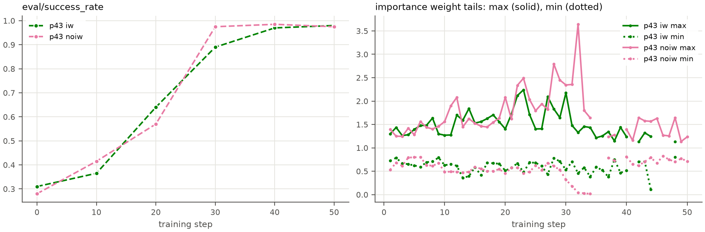

*Figure 9: `eval/success_rate` for iw vs. noiw (left); importance-weight max (solid) and min (dotted) for both runs (right).*

With staleness up to 4, no groups were dropped in either run, so both trained on more off-policy data than p3. PPO (iw) uses the importance ratio and clips large values, which keeps updates close to the sampling policy. Weighted cross-entropy (noiw) ignores the ratio. Both runs kept a mean importance weight of 1.000. noiw showed one burst of much heavier tails around steps 30–34 (min 0.019, max 3.64, std 0.082), but over the full run its importance-weight std was only modestly higher than iw's (0.030 vs. 0.026), and iw had its own dip to 0.107 at step 44, so the evidence that dropping the ratio caused extra drift is suggestive rather than conclusive. Final quality was nevertheless the same: 0.980 for iw vs. 0.975 for noiw. Number Search is easy and converges in about 35 steps, so the drift never grew into instability. A harder task, longer training or higher staleness would likely show a gap.

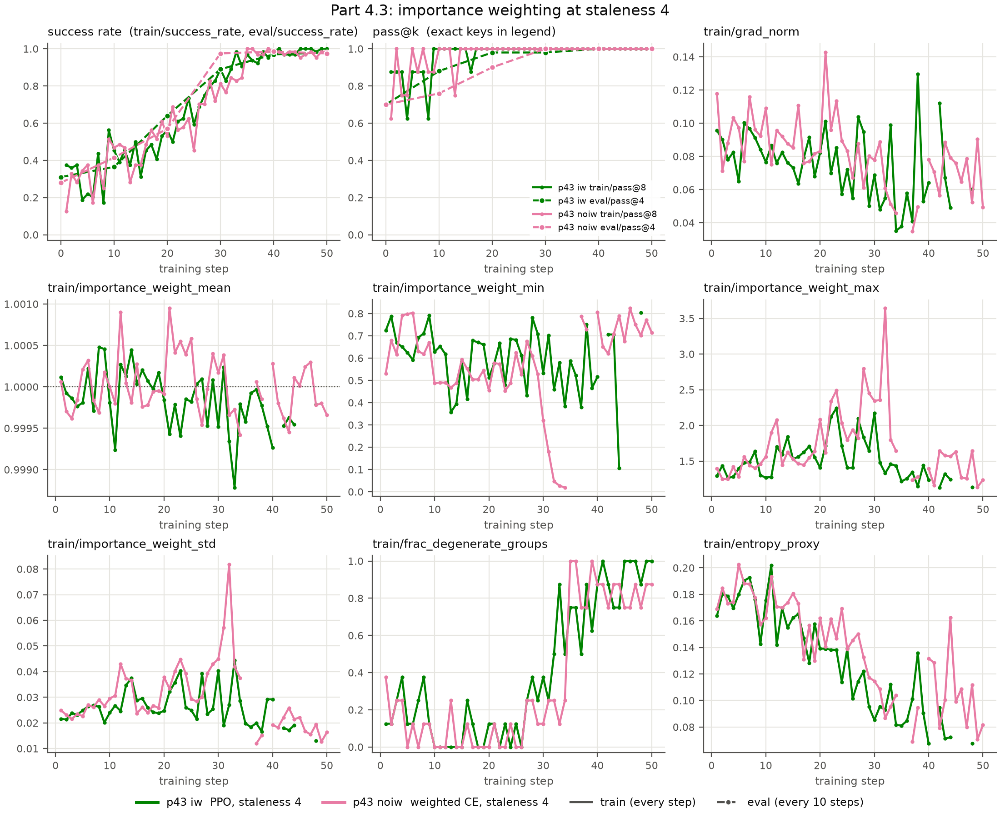

*Figure 10: Standard diagnostics, iw vs. noiw. Training success and `train/pass@8` rise almost identically (`train/pass@8` is 1.0 from step 17 for iw and step 14 for noiw), and `eval/pass@4` reaches 1.0 by step 40 (iw) and step 30 (noiw). `grad_norm` is similar (mean 0.075 vs. 0.082); noiw has the single largest spike, 0.14 near step 21. Both degenerate fractions climb past 0.75 after steps 30–35 as the task is solved, and entropy falls to 0.07 (iw) and 0.09 (noiw).*

## Part 5: TextCraft-Synth

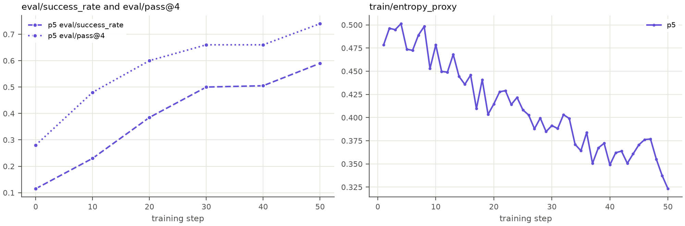

*Figure 11: p5 `eval/success_rate` and `eval/pass@4` on 50 medium validation tasks (left); `train/entropy_proxy` (right).*

| model | split | success_rate | pass@4 |
|---|---|---|---|
| base Qwen3.5-4B | medium | 0.130 | 0.338 |
| fine-tuned (step 50) | medium | 0.634 | 0.756 |
| base Qwen3.5-4B | hard | 0.000 | 0.000 |
| fine-tuned (step 50) | hard | 0.000 | 0.000 |

The run itself:
- **Length and stability.** The single async GRPO run took about 12 hours and was stable: 0 groups dropped as stale, a mean importance weight of 1.000, and a steadily falling entropy without collapse.
- **During training.** In-training eval success rose steadily, from 0.115 to 0.59.

Final evaluation:
- **Medium split.** Success rose about 4.9× (0.130 to 0.634), and episodes got shorter on average (48.9 vs. 62.3 steps). Coverage improved too: pass@4 went from 0.34 to 0.76.
- **Hard split.** Both models score 0, and the step budget explains much of it. Every task allows 75 steps, yet 88 of the 136 hard tasks need more than 70 `craft` calls even with batching. Training tasks needed at most 59 crafts and were at most 6 levels deep; hard tasks are 7–9 levels deep. The fine-tuned model used nearly the whole budget (72.4 steps) without finishing, so its gains didn't extend to longer, deeper tasks than it was trained on.

Nine of the 2,792 evaluation episodes were lost to parser exceptions or transient `502` errors and counted as failures, a negligible effect (≤ 0.6 points).

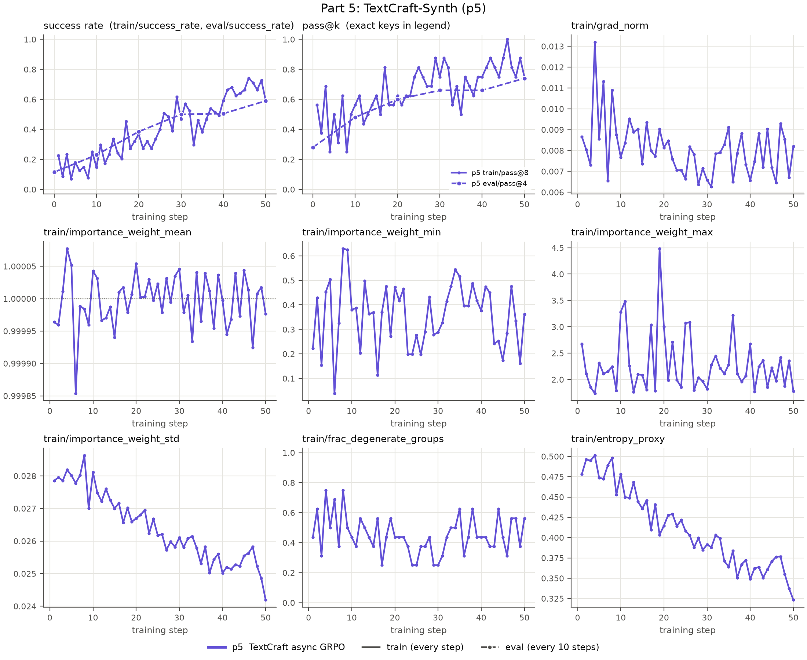

*Figure 12: Standard diagnostics, p5. Training success rises from 0.16 (steps 1–5) to 0.69 (steps 46–50), and `train/pass@8` from 0.46 to 0.83 (steps 1–10 vs. 41–50). `grad_norm` is an order of magnitude smaller than on Number Search (about 0.008) and stays flat. The importance-weight std stays around 0.025–0.028, while the max reaches 4.48 at step 19, the largest tail of any run. The minimum is also heavy-tailed, swinging between 0.04 (step 6) and 0.63 (step 8) with no trend. Long thinking-enabled episodes sampled up to four versions stale contain many low-probability tokens, so a few extreme ratios per batch are expected, and PPO clipping bounds their effect. The mean stays within 0.0002 of 1 throughout. The degenerate fraction stays between 0.25 and 0.75 throughout, so most steps still have informative groups.*
